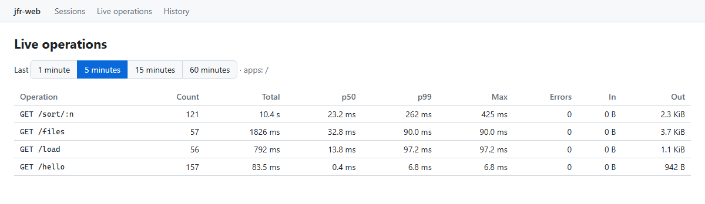
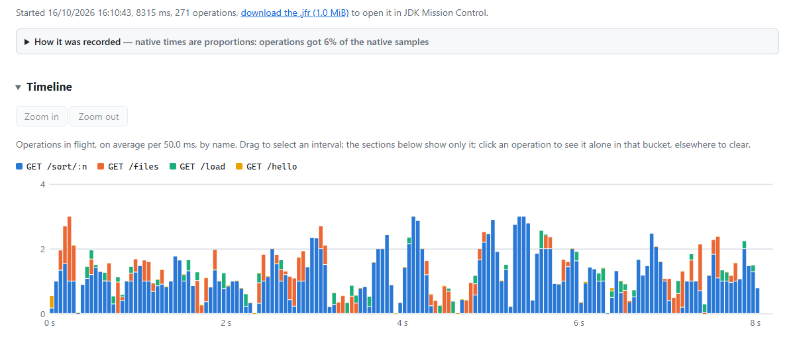
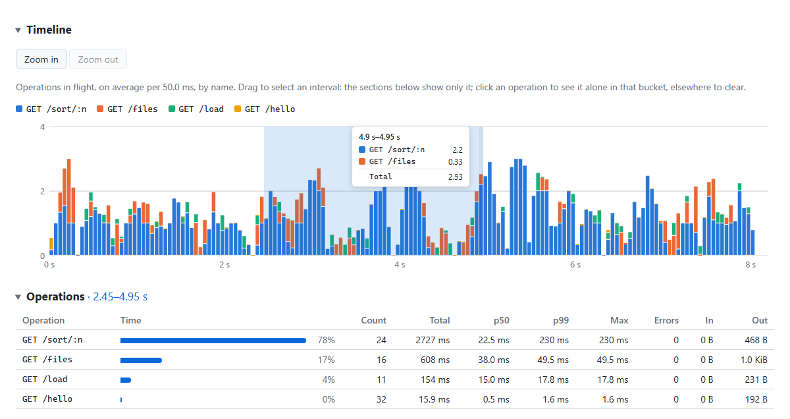
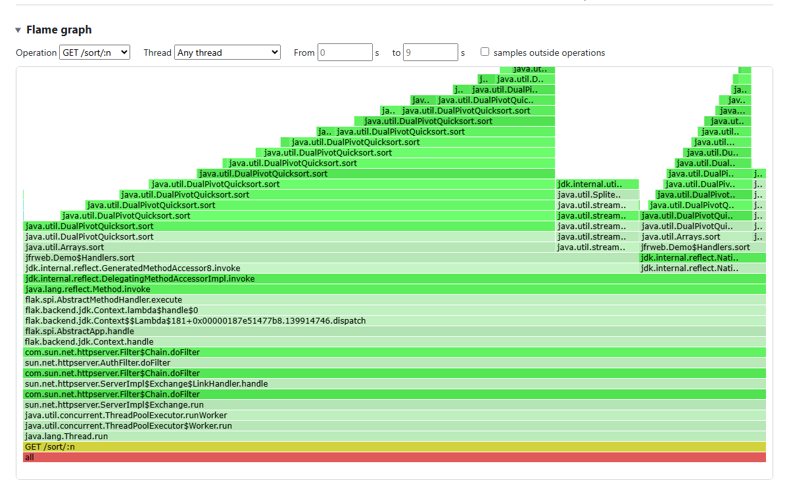
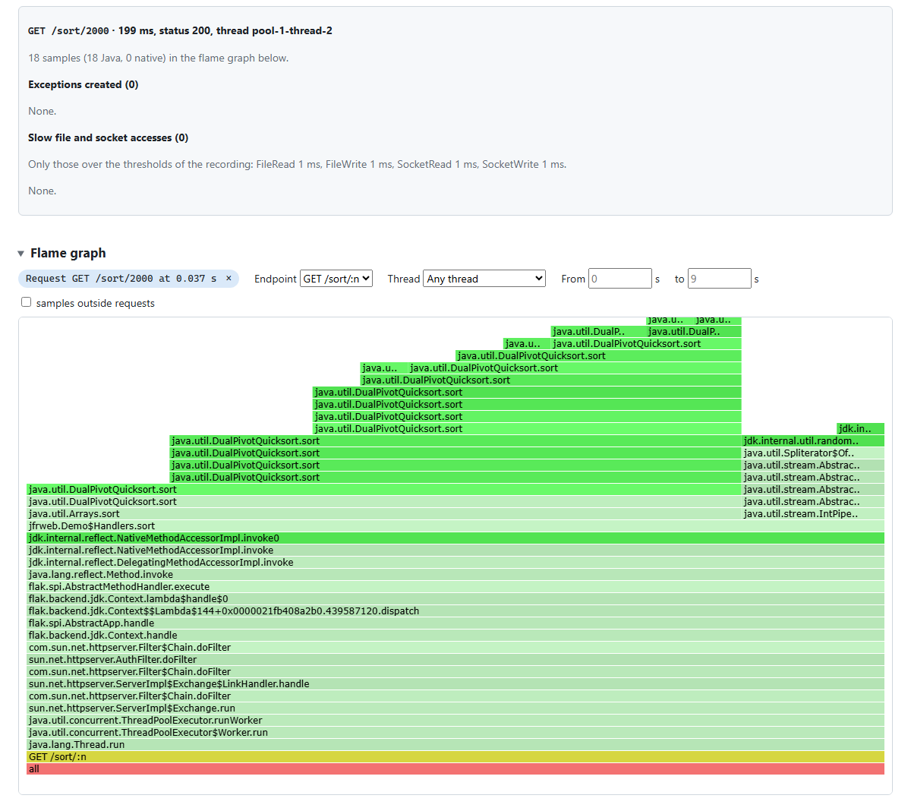
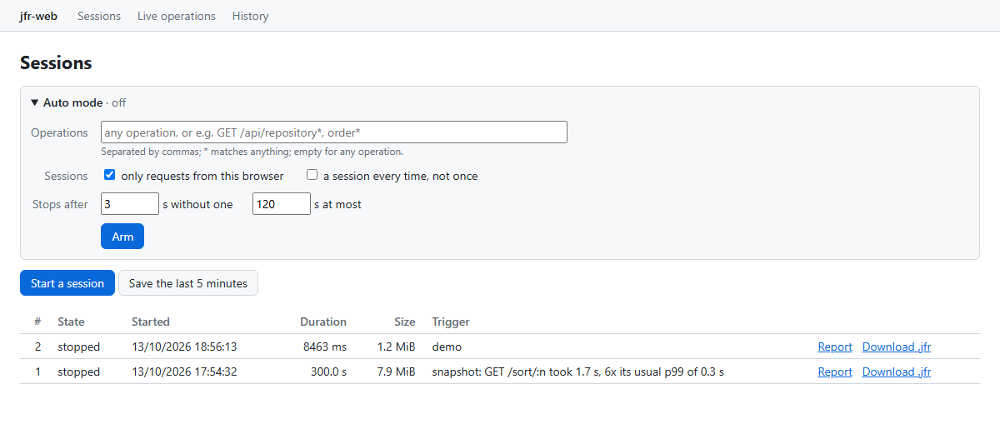
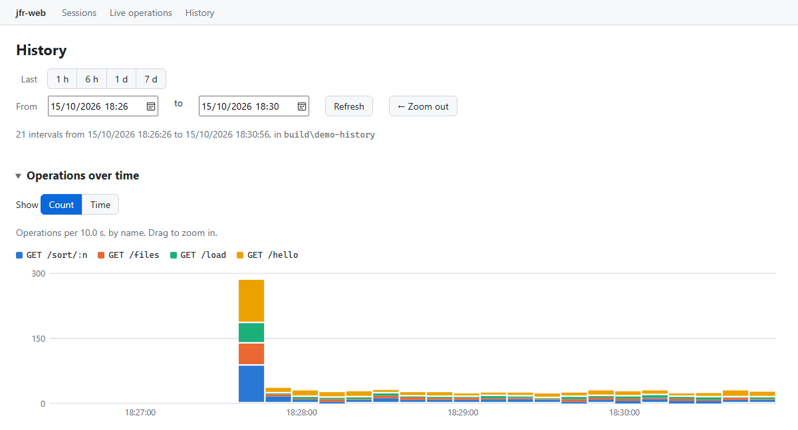
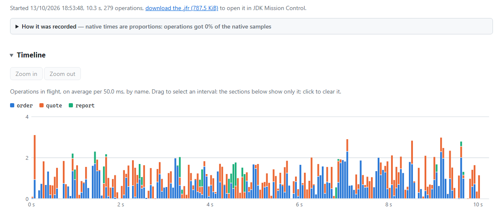
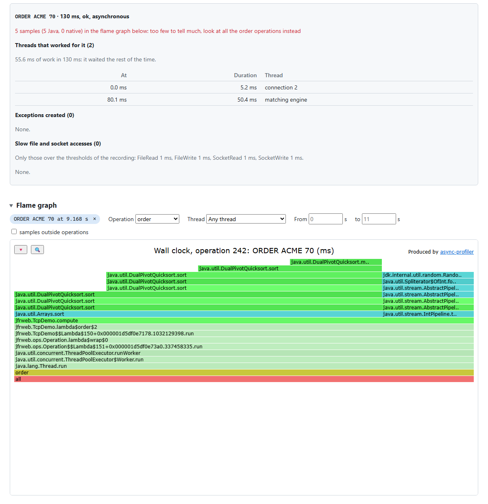

# jfr-web

A profiler embedded in a JVM, with a web interface. It records with Java Flight Recorder, so
it needs no agent or native library and runs everywhere the JDK does, Windows included.

It groups what it sees by **operation**: a unit of work of the application, and which operation
every sample belongs to. In a [flak](https://github.com/pcdv/flak) application, operations are
the requests, grouped by route, with no annotation. Any other application declares its own with
a few lines (see [Any application](#any-application-operations)). It then shows the most
expensive operations, a timeline of those in flight, and flame graphs per operation or per
slow one.

## Getting it

Java 17 or later. Released on [JitPack](https://jitpack.io/#pcdv/jfr-web), with flak:

```groovy
repositories {
  maven { url 'https://jitpack.io' }
}

dependencies {
  implementation 'com.github.pcdv:jfr-web:0.1.0'
}
```

## Features

```java
Profiler.builder().observe(app).start();   // serves the interface on loopback, logs its URL
```

- **Live operations**: the operations of the last 1 to 60 minutes (count, total time,
  p50/p99/max, errors, bytes), kept by counters whether a session records or not.

  

- **Sessions**: start one, use the application, stop it. Its report states how it was recorded,
  shows a timeline of the operations in flight by name (drag to select an interval), lists the
  operations by total time and the slowest of them, and shows flame graphs by operation, thread,
  interval or single operation. An operation also shows the exceptions it created and its slow
  file and socket accesses. The `.jfr` file can be downloaded, e.g. for JDK Mission Control.

  

  An interval selected on the timeline, or zoomed in on, narrows the sections below it:

  

  Flame graph of the requests of a route, picked in the table:

  

  A single request, with its exceptions, slow file and socket accesses, and flame graph:

  

- **Auto mode**: sessions start by themselves when a matching operation begins (name patterns,
  and/or only the requests of the browser armed), before it runs, and stop once no matching
  operation has run for a few seconds; once or every time.

  

- **Operation history**, for production: no profiling, only the counters of the operations
  written to disk at a regular interval, in hourly files purged by age and size. It runs alone;
  the profiler's History page and the `history` command read it.

  

```java
OperationHistory.builder()
                .directory(Path.of("logs/operations"))  // dedicated: what it holds may be deleted
                .interval(Duration.ofMinutes(1))        // the defaults: 1 minute,
                .maxAge(Duration.ofDays(7))             // 7 days,
                .maxSize(100L << 20)                    // 100 MiB
                .observe(app)
                .start();
Profiler.builder().observe(app).history(Path.of("logs/operations")).start();   // to browse it
```

```sh
./gradlew run --args="history logs/operations --from 2026-10-13T10:00 --to 2026-10-13T11:00"
```

- **Snapshots**, for production too: a rolling recording keeps the last 5 minutes, with the JDK's
  light settings, and saves them when something goes wrong, with nothing to configure: an
  operation 4 times slower than the usual p99 of its name (and over 1 s), or a burst of errors.
  Also saved by
  hand, e.g. right after a problem. They are listed with the sessions, with why they were taken.
  The sessions page above shows one, with the button to take one by hand.

```java
Snapshots snapshots = Snapshots.builder()
                               .directory(Path.of("logs/snapshots"))   // dedicated, kept across restarts
                               .observe(app)
                               .start();
Profiler.builder().observe(app).snapshots(snapshots).start();          // to list and take them
```

A builder sets the rest: address, port, guard, directory of the recordings, JFR settings, or
mounting on an existing flak server:

```java
Profiler.builder()
        .mount(factory, "/profiler")     // one more app on the server of an AppFactory
        .guard(loginCheck)               // a BeforeHook; by default, non-local clients are refused
        .start();
```

jfr-web depends on flak's JDK backend, so that `Profiler.start()` works in any application. A flak
application on Netty should then pick its backend explicitly: `Flak.getFactory()` takes the first
one it finds on the classpath.

To try it: `./gradlew demo -Pdemo.session=true` runs a small flak app with the profiler, records
a first session, and prints the URLs. The screenshots above come from it, with
`-Pdemo.load=true` for background traffic: `node docs/screenshots/capture.mjs <profiler URL>`
takes them again, in headless Edge or Chrome.

### Any application: operations

An application that is not a flak app declares its operations, and gets the same features: live
statistics, history, snapshots, auto mode, and in sessions, timeline and flame graphs by
operation. The profiler, the history and the snapshots hear of them with no `observe()`.

```java
try (Operation op = Operations.begin("quote").detail(symbol)) {   // grouped by name
  ...
}
```

A synchronous operation runs on the thread that begins it, which works only for it until it
ends. An asynchronous one may end on any thread, e.g. when a reply is sent from a callback: its
duration is that of the whole, including the time it waited, and its samples are those of the
threads that declare working for it, in segments.

```java
Operation op = Operations.beginAsync("order").detail(line);
engine.execute(op.wrap(() -> {    // a segment: this thread works for the operation
  ...
  op.close();
}));
```

`op.failed(e)` counts it among the errors. Recordings get operations from the `jfrweb.Operation`
event, which the sessions and snapshots of jfr-web enable.

`./gradlew tcpDemo -Pdemo.session=true -Pdemo.load=true` runs an order server over TCP, which
does not speak HTTP, with clients of its own. Its quotes are synchronous; its orders are checked
on the connection's thread, then wait for the matching engine, a single thread, which replies:



An order: 5 ms on the connection's thread, 50 ms on the engine's after 80 ms in its queue. Its
flame graph only has the samples of its segments:



### Offline analysis

A recording made outside jfr-web can be analyzed from the command line:

```sh
./gradlew run --args="report app.jfr"                    # how it was recorded, operations table
./gradlew run --args="flame app.jfr -o flame.html"       # wall-clock flame graph, rooted by operation
./gradlew run --args="flame app.jfr -o busy.html --operation 'GET /api/.*'"
```

`flame` takes `--thread <regex>` to keep some threads, `--all` to add the samples taken outside
operations, and `--collapsed` for collapsed stacks instead of HTML.

The recording must enable flak's request event (flak 3.4.0+) or jfr-web's operation events
(`jfrweb.Operation` and `jfrweb.OperationSegment`), which are off by default:
`recording.enable("flak.Request")`, or in a `.jfc` file. The `profile` settings of the JDK
sample Java code every 10 ms and native calls every 20 ms.

To record an application that is already running, with no change to it (JDK 21):

```sh
jcmd <pid> JFR.start name=jfrweb settings=profile +flak.Request#enabled=true
# ... run the workload ...
jcmd <pid> JFR.dump name=jfrweb filename=workload.jfr
jcmd <pid> JFR.stop name=jfrweb
```

### Static export

The interface and some recordings can be written as a static site, which any web server serves
with no Java behind it, e.g. to share a report or publish a demo:

```sh
./gradlew run --args="export app.jfr other.jfr -o site/ --history logs/operations"
./gradlew tcpDemo -Pdemo.export=site/       # the TCP demo: a session, 3 minutes of history
```

The responses of the REST API are computed beforehand, for everything that can be reached by
clicking. What takes a free input is left out: an interval selected on a timeline, the From and
To of a flame graph, filters combined.

Before publishing one, mind what a recording holds: the environment variables and system
properties of the JVM, unless its settings turned them off (`jdk.InitialEnvironmentVariable`,
`jdk.InitialSystemProperty`), and its command line. Recordings running at the same time share
their events. `--no-recordings` leaves the `.jfr` files out of the site.

- [docs/requirements.md](docs/requirements.md): what the project must do
- [ROADMAP.md](ROADMAP.md): milestones, what is done and what comes next

## License

[Apache License 2.0](LICENSE).
